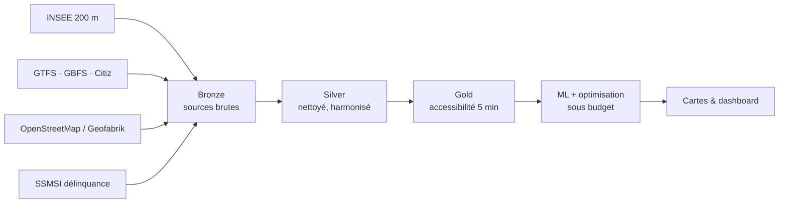

# Citiz Intelligence

**Où installer les prochaines stations d'autopartage Citiz ? De l'open data à la décision.**
Hackathon *Mobility — From Open Data to Location Decisions* · EPITECH T-HAK-700 · Microsoft Fabric

Citiz Intelligence mesure ce que chaque habitant peut rejoindre **en 5 minutes à pied** sur le vrai réseau piéton, repère les zones mal desservies, **prédit** la population atteignable depuis de nouveaux sites (ML) et **sélectionne** les meilleurs emplacements sous contrainte de budget.

Périmètre : France métropolitaine, Martinique et La Réunion.

---

## Résultats clés

| Indicateur | Valeur |
|---|---|
| Carreaux INSEE 200 m analysés | **2 324 577** |
| Points de mobilité (arrêts, stations, véhicules) évalués | **363 780** |
| Stations Citiz existantes | **1 503** |
| Modèle ML (régression, test spatial) | **R² 0,69** · MAE 366 hab. (référence : 1 518) |
| Scénario 500 k€ | **15 stations**, **32 303** habitants gagnent une première option de mobilité |

| Budget | Sites retenus | Dépense 1re année | Habitants gagnant une 1re option |
|---|---:|---:|---:|
| 250 000 € | 7 | 225 992 € | 19 939 |
| 500 000 € | 15 | 477 000 € | 32 303 |
| 750 000 € | 23 | 732 778 € | 42 818 |

---

## Structure du dépôt

```
.
├── Fabric-final/          # LIVRABLE : notebooks du pipeline complet (Bronze → Silver → Gold → ML)
├── Fabric-CLI-import/     # Export brut du workspace Fabric (notebooks exploratoires, lakehouses, KQL)
│   └── noteBook-divers/
└── presentation/          # Support de soutenance (.pptx) et cartes interactives HTML
```

- **`Fabric-final/`** contient tout ce qui est rendu : les notebooks qui construisent les données et le modèle, plus le modèle sémantique `sm_mobility_test`.
- **`Fabric-CLI-import/`** est l'export du workspace via Fabric CLI : pistes exploratoires (OSM, IGN, revenus, vélo), chaîne **criminalité** (`NB_bronze_criminel` → `NB_Timo_02_Silver_criminaliter` → `NB_Gold_criminaliter`, Eventhouse `carte-criminalite`) et métadonnées des Lakehouses `lh_mobility_citiz` et `carte_crimininaliter_V2`.

---

## Architecture médaillon



| Couche | Contenu |
|---|---|
| **Bronze** | Fichiers sources tels que reçus (CSV, ZIP, JSON, PBF) + manifeste de provenance |
| **Silver** | Coordonnées validées, modes harmonisés, disponibilité déclarée, dédoublonnage ciblé |
| **Gold** | Couverture 5 min, population desservie par station, prédictions ML, scénarios budgétaires |

---

## Pipeline : notebooks de `Fabric-final/` (à exécuter dans l'ordre)

| Notebook | Rôle | Tables principales produites |
|---|---|---|
| `NB_01_Ingestion_GTFS_CTS` | Pilote GTFS sur le réseau de Strasbourg | — |
| `NB_02_Clean_GTFS_CTS` | Nettoyage du pilote CTS | `silver.cts_stops`, `cts_routes`, `cts_trips`, `cts_stop_times` |
| `NB_03_Ingestion_France_Transport` | Arrêts de transport nationaux (data.gouv) + contrôle de provenance | `silver.france_transport_stops` |
| `NB_04_Ingestion_GBFS_France` | Stations Citiz et services partagés GBFS | `silver.france_citiz_stations`, `france_gbfs_station_locations`, `france_gbfs_vehicle_locations_dedup` |
| `NB_05_Ingestion_INSEE_Population` | Carreaux INSEE 200 m géocodés, agrégats H3 | `silver.france_population_200m_geocoded`, `france_population_h3_r7/r8` |
| `NB_06_Accessibilite_Multimodale-1` | Unification des points de mobilité, proxy 360 m à vol d'oiseau (étapes 26A–27) | `silver.france_mobility_points_unified`, `gold.france_access_mobility_proxy_200m` |
| `NB_07_Accessibilite_Pietonne_Nationale` | **Marche réelle 5 min sur graphe OSM**, population desservie par station (étapes 28–31B) | `gold.france_access_walk_5min_national_200m`, `..._bilan`, `gold.france_stations_arrets_5min_population_desservie` |
| `NB_08_Citiz_ML_Optimisation` | Candidats, ML, simulation OSM, sécurité, coûts, optimisation (étapes 32–33) | `gold.citiz_32*`, `gold.citiz_33*` |
| `NB_09_Dashboard_Decisionnel_Citiz` | Dashboard interactif et portail (étapes 34–37) | `Files/gold/maps/*.html` |

> `NB_06_Accessibilite_Citiz` et `NB_06_Accessibilite_Multimodale` sont des versions intermédiaires ; la version de référence est `NB_06_Accessibilite_Multimodale-1`.

**Paramètres de marche :** 300 s × 1,2 m/s = 360 m sur le réseau piéton OSM, depuis le centroïde de chaque carreau. Le calcul national est découpé en 32 lots reprenables.

---

## Machine Learning et optimisation

1. **Présélection** : 1 010 zones mal desservies, puis 1 924 sites candidats (parkings OSM, arbres, distance aux stations existantes).
2. **ML** : `HistGradientBoostingRegressor` (scikit-learn) prédit la population atteignable à 5 min à partir de 4 variables démographiques. La validation est **spatiale** (`GroupShuffleSplit` par hexagone H3 R5) pour éviter la fuite géographique. Le modèle est suivi dans MLflow Fabric.
3. **Vérification** : les 485 meilleurs sites sont recalculés sur le vrai réseau piéton OSM.
4. **Enrichissement** : taux communaux de délinquance SSMSI (informatifs, sans pénalité automatique), arbres à moins de 15 m, coûts sur 1 an et 5 ans.
5. **Optimisation gloutonne sous budget** :
   `score = (nouveaux habitants avec une 1re option + 0,45 × nouveaux habitants avec l'autopartage) / coût`.
   Les carreaux déjà couverts ne sont jamais comptés deux fois.

---

## Reproduire le projet

**Prérequis :** un workspace Microsoft Fabric avec une capacité Spark et un Lakehouse `lh_mobility_citiz` attaché aux notebooks.

1. Importer les notebooks de `Fabric-final/` dans le workspace, via l'intégration Git de Fabric ou `fab import`.
2. Attacher le Lakehouse `lh_mobility_citiz` comme Lakehouse par défaut.
3. Exécuter les notebooks **de NB_01 à NB_09 dans l'ordre**. Chaque notebook installe ses dépendances (`%pip install h3 folium branca osmium networkx scipy scikit-learn …`).
4. Les cartes HTML sont générées dans `Files/gold/maps/` du Lakehouse.

> Le calcul OSM national (NB_07) est la partie la plus longue. Il peut être relancé lot par lot sans refaire les lots terminés.

---

## Livrables visuels (`presentation/`)

| Fichier | Contenu |
|---|---|
| `mobilite_5min_stations_3_INDICATEURS_{metropole,martinique,reunion}.html` | Accessibilité 5 min à pied : couverture, diversité des modes, options par habitant (zoom jusqu'au carreau 200 m) |
| `carte_delinquance-2.html` | Délinquance enregistrée à l'échelle communale (SSMSI) |
| `*.pptx` | Support de soutenance |

Les cartes s'ouvrent dans un navigateur et nécessitent Internet pour les fonds de carte.

---

## Sources de données

[INSEE](https://www.insee.fr/) (carreaux 200 m, Filosofi) · [transport.data.gouv.fr](https://transport.data.gouv.fr/) (GTFS) · [GBFS](https://github.com/MobilityData/gbfs) et [Citiz](https://citiz.coop/) · [OpenStreetMap](https://www.openstreetmap.org/) via [Geofabrik](https://download.geofabrik.de/europe/france.html) · [SSMSI](https://www.data.gouv.fr/datasets/bases-statistiques-communale-departementale-et-regionale-de-la-delinquance-enregistree-par-la-police-et-la-gendarmerie-nationales) · [API Géo](https://geo.api.gouv.fr/)

---

## Limites assumées

- Population atteignable ≠ réservations : l'usage réel reste une hypothèse, faute d'historique Citiz.
- Les coûts sont des **hypothèses de démonstration**, pas un devis Citiz.
- Un parking OSM n'est pas une place libre vérifiée : une validation terrain reste nécessaire.
- « Non évaluable » ne veut pas dire « sans mobilité » : ces carreaux sont exclus du dénominateur.
- Vie privée : agrégation au carreau de 200 m, statistiques de sécurité à l'échelle communale.

**Prochaine étape :** intégrer les historiques de réservation Citiz pour chiffrer l'usage et l'impact carbone.
